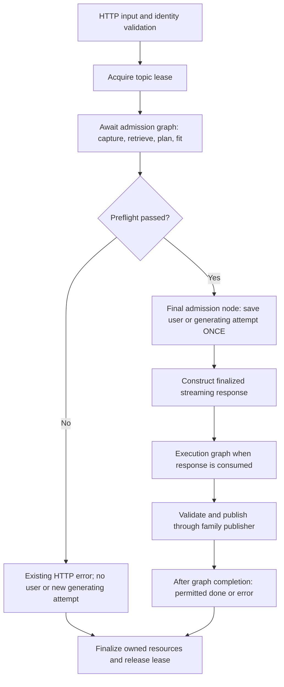
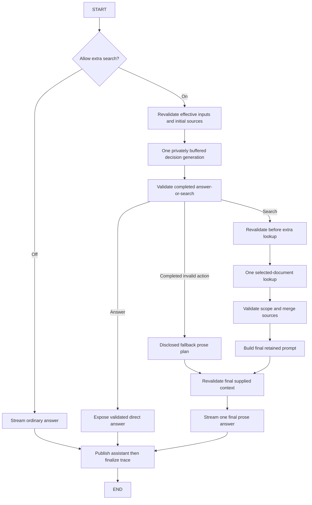

# Pivot to LangGraph

Date: **20 October 2026**. Status: **research and design complete and validated by executed spikes; implementation in progress** (see the 20 October [validation research](2026_10_20_langgraph_validation_research.md), [validation design](2026_10_20_langgraph_validation_design.md), which amends shielding, tracing, recursion-limit, node-execution and consumer mechanisms, and the [implementation record](2026_10_20_langgraph_implementation.md)). Original status at consolidation: implementation proposed, not started. Application baseline: `63d0e84` on `dev`. This is Tanmay's requested consolidated implementation plan. Separate source records: [research](2026_10_20_langgraph_research.md) and [design](2026_10_20_langgraph_design.md). Both agents completed naturally; the coordinator owns this synthesis and Git. No application code, dependencies, models or personal data were changed during planning.

## 1. Why we are pivoting

Learning LangGraph is an explicit R1 objective. It is also the intended architecture for inspecting and extending learning workflows. The coordinator incorrectly treated it as an optional dependency to avoid. Tanmay's correction supersedes the earlier deferral in the [15 October discussion](../evidence-retrieval/2026_10_15_evidence_retrieval_discussion.md). Preserve that report and the [implemented custom-workflow history](../evidence-retrieval/2026_10_19_evidence_retrieval_implementation.md); do not rewrite their history as if LangGraph had been implemented.

The pivot replaces workflow sequencing and routing with **real LangGraph nodes and edges**. It retains the independent parsing, retrieval, prompt budgeting, local Ollama gateway, profile, source validation and application stores. A one-node wrapper around the complete old orchestrator is not completion. Nor is installing LangGraph and leaving ordinary chat, summaries and prerequisites on unrelated custom engines.

The migration should teach graph state, nodes, conditional edges, dependency injection, async execution, streaming boundaries and failure ownership. Framework benefits must be demonstrated in the resulting code and walkthrough; better performance or answer quality is not assumed.

## 2. Scope and completion boundary

| Workflow | Target after this pivot |
| --- | --- |
| Default/named ordinary chat | LangGraph admission and execution. |
| Default/named optional extra search | Conditional chat graph branches; same model and existing budgets. |
| On-demand section summaries | Summary admission and execution graphs. |
| Personalized prerequisite generation | Prerequisite admission, validation and publication graphs. |
| Outline build/read | Existing deterministic Docling/domain service, usable by graph nodes. |
| PDF/CV ingestion and indexing | Existing parser/indexing services; no ceremonial graph wrapper. |
| Summary/prerequisite imports | Existing explicit idempotent main-chat transactions; no automatic inference. |
| My proficiency and other CRUD | Existing domain/store APIs. |
| Hybrid retrieval/embeddings | Existing scoped service/gateway called by nodes and ingestion. |

This is an orchestration migration, not a full-codebase rewrite. All generative workflow orchestration is in scope; not every function becomes a graph.

Initial graph execution is **request scoped**, with `checkpointer=None` and no LangGraph Store. Existing app records stay authoritative. Persistent restart/resume, human-interrupt approvals, understanding checks, progress memory, native tool protocol and compaction are distinct R1 capabilities. Section 11 specifies their extension seams and durable prerequisites now; their absence must remain visible in the roadmap. They are not silently delivered or silently removed from R1 by this pivot.

## 3. Selected architecture and decision path

| Question / alternatives | Choice and reason | What would change it |
| --- | --- | --- |
| One universal graph vs family graphs | Three families sharing runtime/event mechanisms. Avoid unrelated state and accidental CV access. | A later common domain contract may justify a shared subgraph; not a universal mutable session. |
| Lazy single graph vs pre-response handshake vs two phases | Await admission graph; then request-bound execution graph. Current preflight precedes saved user/headers. | If equivalence tests fail, investigate an explicit pre-response handshake before product cutover. |
| Existing HTTP gateway vs ChatOllama/high-level agent | Keep existing gateway and options. Separate orchestration from protocol migration. | A separately approved provider/tool capability requires its own evidence/tests. |
| Synchronous custom writer vs credit-gated writer vs async sink | Bounded async application sink plus owned `graph.ainvoke()` task. Research found the examined custom-event queue unbounded. | Failed backpressure/cancellation spike reopens the runtime seam; credit gating is the credible alternative. |
| Graph checkpoints vs current stores | Current stores remain published truth. No persistent graph state initially. | Durable operation/staging/reconciliation contract passes its own gate. |
| Graph node wraps old engine vs real stages | Nodes own decision, lookup, plan, generation, validation, publication. Delete old engine. | No wrapper exception; pure helpers can remain. |
| Big-bang vs staged cutover | Small passing gates, explicit cutover per complete path/family, then removal. | No runtime fallback or shadow model runs. |

The research verifies current [StateGraph/runtime contracts](https://docs.langchain.com/oss/python/langgraph/graph-api) and [streaming mechanisms](https://docs.langchain.com/oss/python/langgraph/streaming), while the design maps them to our existing admission/publication obligations. No dependency or runtime spike has yet proved the proposed integration.

### Admission and execution



**There is one admission save.** The write shown above is the last admission node; the HTTP adapter does not save again. Existing early trace creation/recovery can occur before it, exactly as today. Recovery may reconcile old attempts; the no-write guarantee concerns the new user/new generating attempt, not all diagnostic/recovery activity.

Admission errors keep existing HTTP status and persistence ordering. Admission cancellation, save failure and response-construction failure must finalize without assuming the response iterator will be consumed. No chat generation occurs during admission; existing retrieval embeddings and model capability reads are preserved.

### Chat execution



Provider failure, oversized/incomplete decision or early EOF goes to error/finalization, **not** the completed-invalid-action fallback. Every effect has the same scope, freshness, budget and provenance guard as today.

Summary admission: recover inactive attempts → resolve current native section → fresh full policy → whole-section plan/fit → save generating attempt. Execution: provider stream → completion/text/label validation → current map check → publish summary → permit done. Preserve prior success on Stop/error.

Prerequisite admission: recovery/reconciliation → current section → eligible canonical full CV/integrity → policy/goal → whole-input fit → generating attempt. Execution: privately buffered schema generation → completion/close → map/CV recheck → requirements/reference validation → pending rows → assessment publication/reconciliation → permit done. No partial cards; familiarity remains independently answered for every requirement.

## 4. State, context and module ownership

### Four kinds of state

| Kind | Contents and owner |
| --- | --- |
| Published application data | Saved conversations/imports, profile/proficiency, completed attempts/results and traces. Existing stores remain authoritative. |
| Graph routing state | Versioned operation/workflow identity, stage/route, source IDs/digests, plan/result references, call attempts, provider status and publication outcome. Prefer replacement updates. |
| Runtime context | Explicit gateway/store/retriever capabilities, captured immutable inputs/settings, confidential prompt/image material, lock/lease handles, artifact slots, event sink, observer and publisher. Per request. |
| UI state | Existing per-message opt-in, transient progress and saved per-answer disclosure. Public NDJSON remains its boundary. |

No `MessagesState`/append reducer by habit: it would introduce another history/message-ID authority. Graph memory does not handle our context budget. Existing builders still protect full policy/question/relevant proficiency and optional full CV; context trimming changes the request, not saved history.

A request-local artifact holder keeps immutable confidential input plus explicit plan/result slots outside routing DTOs. It is ephemeral, not another learner database. Reusable compiled graphs must not capture mutable requests in closures. Compile at app composition, create fresh context per run, track active tasks through lifespan, and avoid import-time resources.

Future checkpointing must not serialize runtime locks, tasks, connections or clients. Ephemeral artifact references do not become resumable by themselves: later durable mode needs verified staged artifacts and state-version compatibility.

### Current-to-target map

Proposed files below do not exist yet. Names are responsibility proposals, not a requirement to create forwarding-only modules.

| Current | Target disposition |
| --- | --- |
| `services/api/lab/web/chat.py` | Keep routes/read API/HTTP adaptation; move sequencing into `workflows/chat.py`. |
| `services/api/lab/evidence_turn.py` | Delete after branch parity; move only reusable pure helpers into appropriate evidence domain modules. |
| `chat_prompt.py`, `chat_session.py`, `context.py` | Retain pure prompt/history/budget contracts. |
| `evidence_request.py`, `evidence_prompt.py`, `evidence_snapshot.py` | Retain action/merge/retained-source/freshness contracts. |
| `web/document_map_summaries.py` | Thin adapter to `workflows/summary.py`; retain existing API. |
| `section_summary.py`, `document_map_summary_store.py` | Retain domain/storage. |
| `web/prerequisites.py` | Keep read/recovery API; graph orchestration in `workflows/prerequisites.py`. |
| `prerequisites.py`, `prerequisite_store.py` | Retain schema, validation and published records. |
| Publication/reconciliation closures | Extract cohesive `workflows/chat_publication.py`, `summary_publication.py`, `prerequisite_publication.py`. |
| `web/middleware.py` | Preserve finalized response; minimal lifecycle adaptation only. |
| `web/deps.py`, `web/app.py` | Compose graph factories/runtime; own app shutdown. |
| `models.py`, `contracts.py`, retrieval/index/parsers/profile/import modules | Retain; no simultaneous provider/domain rewrite. |

Shared proposed modules: `workflows/types.py` (DTOs/protocols), `events.py` (allowlist/bounded sink), `runtime.py` (run handle/observer/artifacts/tasks). A `web/workflow_response.py` is justified only if it is a cohesive small HTTP adapter, not a second engine. New graph/runtime modules must remain independent of FastAPI/Starlette; domain errors map at HTTP as today.

## 5. Runtime, stream and publication contract

### Bounded stream

Nodes await an application sink while an owned task runs `graph.ainvoke()`. HTTP consumes allowlisted existing events, never raw framework values/updates/debug/checkpoints/callbacks. The selected approach intentionally does not use the synchronous custom writer for provider-token transport.

Initial design values, subject to spike: eight outstanding events; split text/thinking into at most 8 KiB UTF-8 fragments without splitting characters; await capacity before reading further provider events. Test concatenation and frontend parsing. Avoid materializing an entire fragment list. Deduplicate safe progress only if existing ordering is preserved.

These values bound outstanding transport buffering, **not total process memory**. Full answers, hidden decision/requirements buffers, histories/source plans, one parsed provider event and terminal domain payloads have separate bounds. Terminal result schemas stay unchanged; analyze their maximum legitimate size rather than truncate them to the text-fragment size. Preserve existing decision byte limits.

### Observer and supplied-source truth

A node can stream and then be cancelled before returning state. The request observer records accepted text before a blocked enqueue, hidden structured bytes separately, call attempts, factory/dispatch milestones, actual supplied-plan IDs/images, completion/close status, timings and publication result. Graph return state alone is not enough to reconstruct partial output. Observed content is not proof of browser receipt.

Do not conflate prepared/available, retained, application-supplied and model-declared evidence. A failed factory can count an invocation attempt without supplying prepared citations. All final supplied sources remain available to display regardless of declared subset. Source labels/counts do not establish semantic support.

### One publisher per family

Normal publication nodes and cancellation/error finalizers call the same owner. HTTP has no independent competing save path. The live-request publication latch/short critical section prevents double-finalization within that request; it is **not crash-safe exactly-once**.

| Family | Required publication ordering |
| --- | --- |
| Chat | Build assistant from observer/actual supplied plan → save assistant/context → finalize trace → permit done. Saved answer survives trace failure; no duplicate incomplete assistant. |
| Summary | Valid completion/labels/current map → durable attempt/result → permit done. Stop/error preserves older success. |
| Prerequisites | Validate/map/CV checks → pending registration → assessment publication → exact-identity reconciliation → permit done. |

Prerequisite ambiguous save: reread actual durable completion; recover that exact result if present. If absent, clean only that assessment's eligible unpublished/unanswered rows. Preserve manual/answered/other/published rows. If state cannot be read, retain rows and disclose uncertainty.

The publisher returns a validated terminal outcome/permission; it does not emit public `done` from inside a still-running node. The runtime must await successful graph completion as well as publication, drain accepted live events, then expose the existing terminal result through the completion outcome. This prevents a node's return/state-update failure after an early `done`. A graph failure after a successful app save preserves that saved result and reports a truthful failure; it must not append an incomplete duplicate. The separate completion signal carries this outcome without needing to enqueue it into a full queue. Test a late graph failure after publication, not just a provider or store failure.

Shield only short publication/outcome bookkeeping; do not shield inference, queue waits or retrieval. Inject cancellation before/after actual saves. Saved completion must never be overwritten by an incomplete result because cancellation arrived before public emission.

### Teardown

1. Mark transport closed; no new public event obligations after disconnect.
2. Cancel the owned graph and any lookup task; await them and close provider iterators.
3. Shield idempotent family finalization; preserve original failure stage plus safe secondary codes.
4. Unregister active attempt/run and release topic lease in outer `finally`.

Use a separate completion signal/task result, not a terminal sentinel that can block on a full abandoned queue. Producer failure must wake the consumer; consumer disappearance must unblock/cancel the producer. Completion without a permitted terminal event is an error, not implicit success. Preserve existing characterized family-specific error sequences.

Retain actual ASGI2.3/2.4 silent-disconnect behavior in `FinalizedStreamingResponse`. Test real request/task cancellation, not only fake nodes raising `CancelledError`. Stop remains prompt terminal cancellation; graph drain/interrupt is not its implementation.

The shared app inference lock still serializes generation and embedding across runs. Per-run `max_concurrency` does not replace it. Do not lock a whole graph: follow-up embedding would deadlock. Close the first decision stream before lookup.

## 6. Behavior-preservation matrix

| Area | Acceptance criterion |
| --- | --- |
| Counts | Ordinary/direct one generation; search at most two/one additional lookup; completed-invalid action existing second prose call, no lookup; incomplete/provider error no repair. No automatic node retries. |
| Context | Same selected model, thinking/context/residency options; full protected policy/question/required learner context. Existing trimming only. |
| CV off/on | Off: no CV registry/artifact freshness reads. On: complete literal canonical extracted text in applicable prompts, not retrieved chunks. |
| Summary inputs | Full section/policy, no accidental main-chat history/CV/goal; same whole-input fit refusal. |
| Prerequisite inputs | Current eligible CV/full section/goal/policy; per-requirement familiarity; no mastery inference or partial actionable JSON. |
| Retrieval | Topic/selection scope, keyword fallback/degradation, mixed indexed/unindexed attachments and zero-index opt-in refusal preserved. |
| Provenance | Labels/pages/images, source hashes, supplied-at-dispatch boundaries, retained-new versus returned-new counts and zero-source disclosure. |
| Freshness | Existing effective projections, not blanket global revisions; actual previously supplied context checked where currently required. No accidental CV reads when off. |
| History/imports | Older records/nullish fields/imported snapshots load unchanged; explicit imports remain idempotent and preserve unsent drafts. |
| Failure/publication | Existing provider/EOF/oversize/save/trace/ambiguous-write semantics and no false done/duplicates. |
| Stop | Partial and empty incomplete outcomes, prior successful result preservation, provider/task/lease cleanup at every stage. |
| Isolation | Different topics, Default/named conversations and app/test roots never share mutable request state. |
| Wire/UI | Same HTTP/OpenAPI/NDJSON shapes; only documented text-fragment granularity may differ. Existing progress/saved summaries remain. |

Do not quietly strengthen unrelated policies during refactor. Example: current summaries check map freshness before publication; that is not continuous policy revalidation. State what current code actually guarantees. Freshness checks are not atomic cross-store snapshots and cannot retract an in-flight prompt.

## 7. Dependencies, network and implementation spike

Research candidate versions on 20 October: LangGraph 1.2.16, checkpoint 4.3.0, Core 1.6.12. SQLite saver 3.1.2 is a later durable-capability candidate, not part of initial installation. These are **unresolved candidate pins**, not an installed-compatible environment. See the separate research report for official package metadata and platform evidence.

Edit `services/api/pyproject.toml` and `requirements-macos-py313.lock`; review `requirements.txt`, Makefile and `.github/workflows/checks.yml` only as needed. Resolve in an isolated supported Python3.13/macOS environment; `pip check`; review transitive native wheels and every changed lock entry. Preserve unrelated pins unless an exact conflict justifies change. Declare directly imported Core/LangSmith APIs directly. No full LangChain/ChatOllama/Platform/CLI/new provider client is required.

LangSmith is transitive in examined Core. Its presence alone is not data transmission, but explicit tracing suppression must surround admission, execution and child-task creation, including hostile inherited settings. Test unexpected outbound networking while allowing intended local Ollama traffic; callbacks-empty alone is not proof. Own environment reads remain in `lab/config.py`. Do not print credential values in evidence. Generate Mermaid text locally; default Mermaid image rendering can call an external service.

The blocking spike proves real graph task cancellation, bounded streaming, publication cleanup and tracing suppression before product wiring. No mocks of LangGraph itself; fake the existing production gateway/store interfaces. If it fails, commit evidence and fix this seam before adding product graph paths. No installation or spike was run for this planning task.

## 8. Bite-sized implementation gates

These are **16 passing gates, not 16 promised commits**. Each row names a coherent scope; split further when a reproduction, extraction or repair deserves its own checkpoint. All proposed new paths are under `services/api/lab/workflows/` unless noted. Tests under `services/api/tests/` use synthetic inputs and isolated roots.

| Gate | Owned paths / meaningful change | Test and exit condition |
| --- | --- | --- |
| **1. Baseline contracts** | Existing chat/evidence/disconnect/summary/prerequisite tests; safe captured fixtures. | Characterizations pass on baseline `63d0e84`; record OpenAPI, event order, histories and traces. Normalize only declared IDs/timings, not provenance/error semantics. No new graph expectation mislabeled a baseline regression. |
| **2. Dependencies** | `services/api/pyproject.toml`, exact lock, required tooling only. | Isolated resolution/install/import + pip check; reviewed lock delta; no import-time tasks/connections. Do not opportunistically upgrade the environment. |
| **3. Channel and observer** | `types.py`, `events.py`, narrow observer/runtime; new unit suites. | Slow consumer blocks producer; queue and fragment bounds; Unicode concatenation; accepted partials before enqueue; raw event rejection; terminal payload limits separately analyzed. |
| **4. Graph task/app lifecycle** | Remaining `runtime.py`, app/deps composition, real tiny graph tests. | Fresh per-run state; cancellation/await; no orphan tasks/iterators or resource capture at import; shutdown during active run. |
| **5. ASGI and privacy** | Minimal finalized-response adaptation, disconnect/privacy suites. | ASGI2.3/2.4 cancellation during silence/tokens/full queue/lock wait; producer and consumer faults; no blocked sentinel; inherited tracing enabled/network canaries; lease release despite cleanup failure. Independent review before product wiring. |
| **6. Chat admission** | Admission nodes in `workflows/chat.py`; route preparation extraction. | Default/named early errors/no user/no headers; indexed/mixed attachments; CV-off/no-read, CV-on/full; protected-fit refusal and old imports. No chat inference during admission. |
| **7. Ordinary execution** | Ordinary node plus extracted `chat_publication.py`; HTTP cutover for ordinary chat. | One call; partial/empty incomplete saves; save-before-trace; trace failure preserves answer; cancel during save; no double finalization. Extract behavior-preserving publisher code separately if possible. |
| **8. Decision/direct nodes** | Buffered decision, completed-action validation/direct path; no complete old-engine wrapper. | Private JSON/thinking; direct one call; strict labels; factory failure supplied-source truth; provider EOF/oversize/error remains distinct from invalid action. Opt-in production cutover waits for gate10. |
| **9. Invalid-action fallback** | Fallback-plan/final-prose nodes. | Completed invalid action only; fixed warning; zero additional lookup; maximum existing calls; truthful final prompt/source accounting; failure of fallback is visible. |
| **10. Extra-search cutover** | Lookup/revalidation/merge/final-plan nodes; enable complete opt-in graph path. | Exactly one extra lookup, close-before-embedding; scope/hash/image/context drift, duplicates/new/trimmed/no-results; failures/cancellation at lookup/final dispatch; no extra inference/retry. Independent chat review and actual synthetic ordinary/search/Stop smoke. |
| **11. Summary admission** | Summary preparation nodes and route extraction. | Full policy/section; fit before generating attempt; stale map; admission construction/cancellation cleanup. Stage new path until execution passes. |
| **12. Summary execution** | `workflows/summary.py`, extracted summary publisher, complete route cutover. | Label/completion/EOF/provider/write faults; prior success survives Stop; source revision check; save-before-done; actual synthetic generate/Stop/reuse/import. |
| **13. Prerequisite admission/generation** | `workflows/prerequisites.py` admission and buffered generation nodes. | Missing/revoked CV zero model calls/new attempt; complete canonical inputs; oversized refusal; bounded buffered schema; no partial cards. Stage until publication passes. |
| **14. Prerequisite publication** | Validation/current-input checks and `prerequisite_publication.py`; route cutover. | Pending-row registration, exact ambiguous-write recovery, unreadable-state ambiguity, protected manual/answered rows, cancellation during publication. Actual synthetic generation/familiarity/edit/import/focused chat; independent review. |
| **15. Remove old engine** | Delete `evidence_turn.py` orchestration, superseded closures/imports/temporary dispatch. | All generative production paths graph-owned; migrate old behavior tests to real graph tests; no dead legacy call, compatibility wrapper for tests, runtime fallback or shadow inference. Pure helpers remain in proper modules. |
| **16. Integrated acceptance/docs** | Canonical architecture/API/study docs, report index, Code R1 snapshot and source/rendered map. | Full gates; baseline OpenAPI/public-wire comparison; independent architecture review; isolated real parser/model/browser journey across all families; exact limitations and local safe diagrams. Then mark pivot complete. |

### How staged cutover avoids duplicate work

New nodes/admission phases can be built and tested before the whole family path is selected by production. Ordinary chat switches at gate7; opt-in at gate10; summaries at gate12; prerequisites at gate14. Until the corresponding path is complete, a request uses its existing complete path. Selection occurs **before admission/dispatch**, so no request performs both preparations or reruns generation after a partially executed graph. Branch-level tests exercise production nodes/interfaces; do not add test-only branches or fake graph behavior in application code.

No exception handler may run the old engine as a fallback. No shadow-run comparison with real models. Avoid a temporary configuration switch where direct scoped cutover works; remove any necessary development switch by gate15. There is no permanent pair of engines to maintain.

### Code → test → fix → proceed

For every gate:

1. Coordinator sets acceptance and one writer per path. Coder reads full policy and code skill; review/usage use their configured roles. Do not repeat research/design merely because implementation starts.
2. Characterize existing behavior first. Commit a scoped failing new regression/architecture test immediately when appropriate; identify whether it passes on baseline.
3. Implement a small cohesive change; inspect staged ownership/privacy; commit tracked WIP even if checks fail. Record exact failures/unrun checks.
4. Run the targeted tests and required affected static/build checks. Fix and commit each meaningful repair; preserve failed checkpoints, no squashing to conceal them.
5. Explain what was learned, alternatives/selected branch, tradeoffs and remaining uncertainty to Tanmay **and** this dated implementation record. Independent review/usage at the specified gates.
6. Only after the current gate's required checks pass start its dependent gate. Checkpoint commits continue during the loop; remote push cadence is separate and requires explicit authorization.

Coordinator owns shared-checkout Git and integration; workers report checkpoints promptly. Parallel work only for genuinely disjoint paths/contracts. Do not set an arbitrary final commit count or accumulate an entire family/feature into a single final commit. Rollback is explicit to a verified checkpoint with stored-format compatibility checked; never hidden rerouting after dispatch.

## 9. Test commands and realistic acceptance

Confirmed existing targeted suites (baseline paths; migrate tests when their old engine is removed):

```sh
PYTHONPATH=services/api .venv/bin/python -m pytest services/api/tests/test_evidence_chat.py services/api/tests/test_evidence_turn.py services/api/tests/test_evidence_snapshot.py services/api/tests/test_evidence_snapshot_cv.py -q
PYTHONPATH=services/api .venv/bin/python -m pytest services/api/tests/test_chat_disconnect.py services/api/tests/test_stream_disconnect.py services/api/tests/test_protected_chat_context.py services/api/tests/test_conversation_learner_context.py -q
PYTHONPATH=services/api .venv/bin/python -m pytest services/api/tests/test_document_map_summaries_api.py services/api/tests/test_section_summary.py -q
PYTHONPATH=services/api .venv/bin/python -m pytest services/api/tests/test_web_prerequisites.py services/api/tests/test_prerequisite_store.py services/api/tests/test_prerequisite_import_api.py -q
```

New suites should explicitly cover graph nodes/routing, runtime lifecycle, backpressure, privacy and publication fault injection; names finalized at the owning gate. Use real LangGraph and fake only the established effect interfaces. Cancellation tests cancel actual tasks/ASGI requests.

Required final checks:

```sh
.venv/bin/python scripts/check_engineering.py
.venv/bin/python -m ruff check .
.venv/bin/python -m ruff format --check .
npm run --prefix apps/web format:check
npm run --prefix apps/web lint
make test
make build
.venv/bin/python scripts/verify_workspace.py --runtime-policy services/api/tests/fixtures/runtime_policy.md
```

Run current CI's stricter tooling Ruff command if its files change. New dependencies also require `pip check`. The initial baseline numbers—683 backend tests plus 21 subtests, 236 web tests—are historical evidence, not the target count or proof of integration. A passing build is not runtime proof.

Use the usage skill and an owned isolated launcher for actual browser verification. Synthetic paper should contain a direct calibration fact, comparison across sections, unsupported claim and relevant source/image identities; synthetic CV carries a canary. Keep an unselected control document. Use installed local model/assets, never downloads or personal topics. Preserve raw evidence ignored under `.local/verification/reports/langgraph-pivot/` and original launcher run directories; stop only owned services.

Actual acceptance covers both chat routes; ordinary/direct/search/fallback; meaningful retained versus duplicate/no-result evidence; CV modes and next-turn proficiency; long-history fit; complete-section summaries; prerequisite generation/familiarity/edit/import/focus; Stop and reload; source links; prior successes; concurrent-topic model serialization; older histories/imports and no cross-run state. Not every fault must use a real model—label injected transport/save/CV failures separately. Check narrow layout/keyboard for changed flows if any UI changes arise. Measure overhead/buffering before making performance claims. Model labels/JSON validity do not prove source support or pedagogical quality.

## 10. Failure matrix and open gates

| Trigger | Expected result / proof owner |
| --- | --- |
| Admission policy/context failure | Existing HTTP status, no new user/attempt; coder/API tests. |
| Admission saved, response never consumed | Finalizer still runs; coder lifecycle tests/reviewer. |
| Graph scheduled, no gateway factory success | Attempt counts honest, supplied citations empty; provenance tests. |
| Provider emits then node cancelled | Observer preserves accepted partials; task/ASGI tests. |
| Slow reader/full queue/disappeared consumer | Bounded pending events and prompt cancellation, no stuck sentinel; runtime spike. |
| Provider done, graph not validated | No complete public result; branch/validator tests. |
| Answer saved, trace fails | Preserve answer, existing error/no false done/no duplicate; publication tests. |
| Cancel after save/before emission | Preserve saved success, no incomplete overwrite; cancellation injection. |
| Summary regeneration fails | Prior saved result and imported snapshot intact; API/browser. |
| Pending prerequisites registered, publication uncertain | Exact-identity read/reconciliation; no destructive cleanup on unreadable state; store/API tests. |
| Freshness drift/out-of-scope lookup | Existing visible stop before next effect; no arbitrary path/model tools; snapshot tests. |
| Two runs/apps/topics | No shared request state, app-wide local inference serialization, separate roots; integration. |
| Tracing inherited/enabled or diagram rendering | No unexpected network/sensitive diagnostics; privacy spike. |
| Node/library exception or recursion guard | Sanitized failure, no automatic retry/old-engine fallback; cleanup and budget tests. |
| Future checkpoint stale/cancelled/version mismatch | No execution until explicit compatible authorized resume; later durable gate. |

Unresolved implementation gates have owners, not assumed success: coder resolves pinned environment and runtime mechanism; independent reviewer verifies lifecycle/architecture/privacy; usage tester proves actual migrated flows. Sink capacity/fragment size and terminal-size bounds are provisional until measured. If dependency pins conflict, report the exact conflict; if sink/ASGI equivalence fails, fix runtime before wiring product paths. Scope changes affecting source authority, retries, stored formats or resume require a recorded design decision rather than silent repair.

## 11. Durable execution and remaining R1 work

The initial pivot does not enable a SQLite saver by default. Current candidate saver brings `aiosqlite` and `sqlite-vec`; serializers need explicit restrictions. See research's [persistence](https://docs.langchain.com/oss/python/langgraph/persistence), [interrupt](https://docs.langchain.com/oss/python/langgraph/interrupts) and [time-travel](https://docs.langchain.com/oss/python/langgraph/use-time-travel) evidence.

Before durable execution:

1. Version operation records and add stable idempotent chat-publication identities; trace ID alone is not a durable turn key.
2. Distinguish execution cursor from published history. Persist verified staged outputs if they must survive without another model call.
3. Define operation identity including workspace, family, topic, conversation/file/section/attempt as applicable, operation ID and graph/state version. Never use global `default` or trust arbitrary browser checkpoint IDs.
4. Terminal cancellation tombstones prohibit later replay; Stop is not pause. No automatic startup replay/time travel.
5. Define constrained state codec/no pickle fallback and test real framework types; open async saver through lifespan and tear it down after active runs.
6. Rehydrate fresh capabilities and check current policy, effective learner/source identities and opted-in CV eligibility before new effects. Do not resurrect revoked CV from old checkpoint text.
7. Reconcile application save and saver commits independently. `durability="sync"` is not an atomic transaction across JSON/profile/trace/checkpoint stores.
8. Explicitly handle saved-app/missing-checkpoint, saved-checkpoint/missing-app and unstaged-output crash windows. Do not claim lost output recovered or regenerate invisibly.
9. Define resume/approval eligibility, UI and narrow validated payloads; release leases while awaiting humans, reacquire/revalidate on resume. Interrupt nodes can reexecute earlier effects.
10. Test retention, WAL/backups/staged-artifact deletion, old versions, concurrency/process failures and safe ambiguity. Row deletion alone is not secure erasure.

| Later capability | Existing migration seam it extends | Still needs design/implementation |
| --- | --- | --- |
| Understanding checks | New family graph + gateway/source/context/publisher | Questions, evidence/rubric validation, learner challenge/correction, attempts/UI. |
| Progress memory | Domain records + deterministic learner projection | Meanings, user corrections, retention and scope. |
| More retrieval/native tools | Validated action nodes/finite edges | Protocol/capability support, budgets and source authorization. |
| Approvals | Explicit authorization stage, later checkpoint/interrupt adapter | Targets/operations/expiry, payload validation, replay safety. |
| Restart/resume | Runtime artifact/operation/publisher boundaries | Durable staging, saver, idempotency and authorized recovery. |
| Compaction, last | Separate proposed-history transformation/publication | Fidelity, citation/policy preservation and acceptance tests. |

These seams avoid replacing all domain modules later. They do not promise zero future refactoring: durable references/state versions and new product behavior still need bounded changes.

## 12. Learning delivery, roadmap and planning verification

At each gate, show the actual graph stages and explain state versus runtime versus saved data, provider completion versus publication, and why the selected branch passed its evidence gate. Generate local Mermaid text from the real compiled topology after implementation; compare it with this intended design. No network-rendered diagram or product-facing implementation jargon is necessary.

Reconcile `references/R1/README.md` instead of appending another contradictory current-status paragraph. It still lists implemented prerequisites as pending. Update the source `system-map.fragment.html` and rendered `system-map.html` together. Mark LangGraph complete only after gate16; preserve dated historical validation and separate understanding/memory/approvals/compaction. Record any out-of-repository ordered-roadmap follow-up explicitly rather than silently editing the runtime learning policy.

Planning checkpoint provenance:

- `111e4a1`: mandatory LangGraph direction/scope and superseded deferral recorded.
- `ad0ae27`: separate completed research, dependency/source evidence and runtime risks.
- `f73b823`: separate completed design, concrete boundaries and 16 passing gates.
- This consolidated plan adds the coordinator's single admission-write and post-graph terminal clarifications, plus cutover staging: complete route selection happens before admission/dispatch, never fallback after partial execution.

The agents did not run application tests/build, install LangGraph, or claim the spikes passed. Coordinator verified existing targeted test filenames and ran engineering/link checks for the saved documents. Separate research and design reports remain available for comparison; this is the consolidated plan. Application tests remain appropriate at implementation gates, not falsely rerun as evidence for documentation-only planning. Local checkpoint commits are required; remote publication of this new plan is separate authorization.
