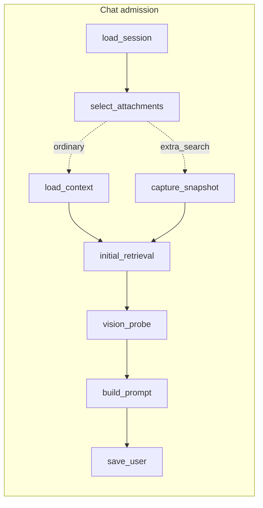
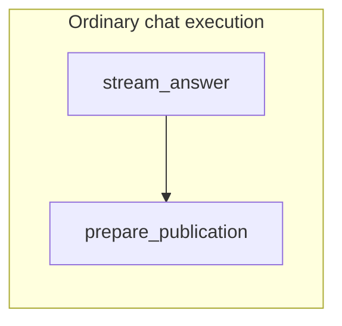
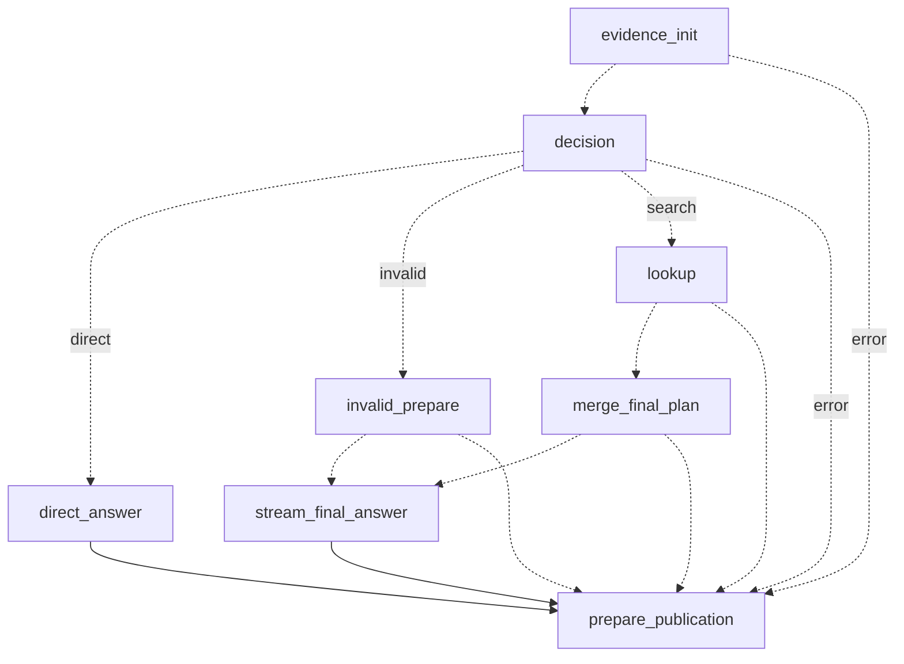
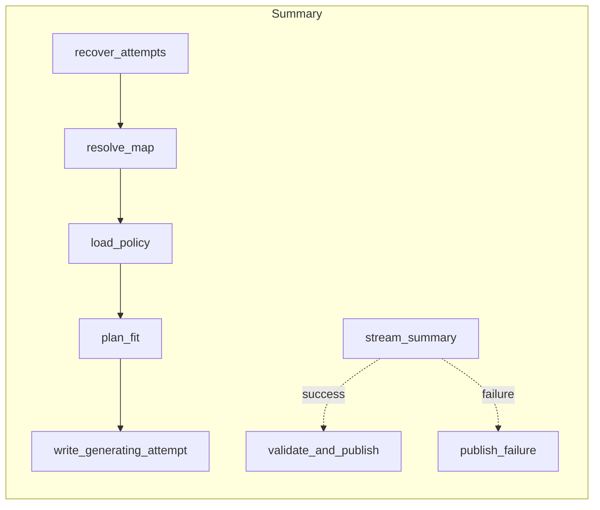
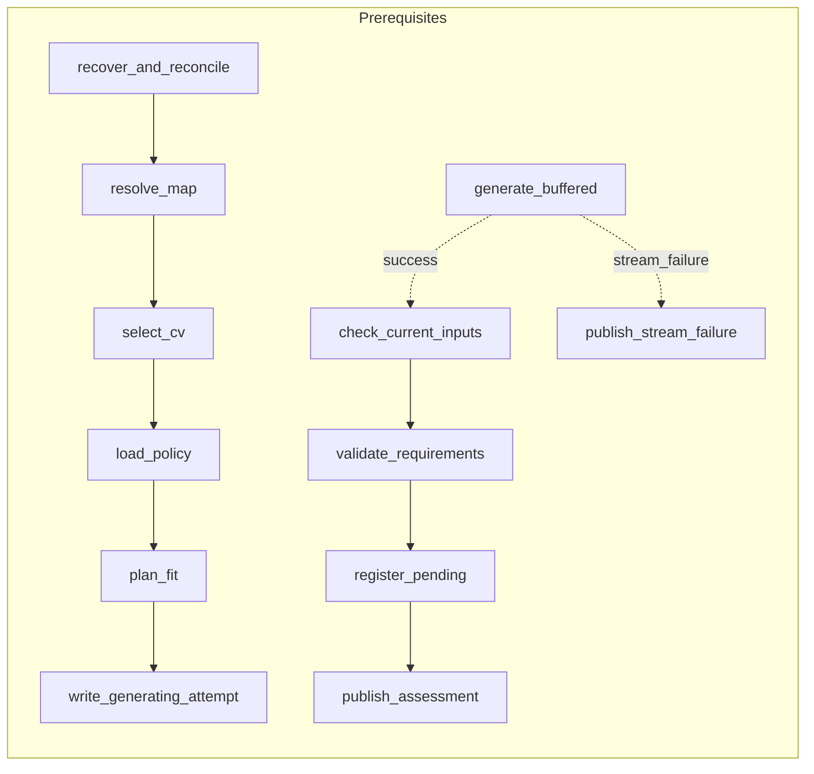

# LangGraph workflows — implementation study path

Chat, section summaries and personalized prerequisites run as LangGraph graphs. The public HTTP and NDJSON contracts did not change: the OpenAPI schema is identical to the pre-pivot baseline, and HTTP characterization tests pin event order, saved records and traces. The [pivot plan](reports/langgraph-pivot/pivot_to_langgraph.md), [validation research](reports/langgraph-pivot/2026_10_20_langgraph_validation_research.md), [validation design](reports/langgraph-pivot/2026_10_20_langgraph_validation_design.md) and [implementation record](reports/langgraph-pivot/2026_10_20_langgraph_implementation.md) hold the decisions, deviations and verification evidence.

Graphs are request-scoped: `checkpointer=None`, no LangGraph Store, no interrupts, no tools. Topic files, sessions, attempts and traces remain the only durable records. Restart/resume, approvals, retrieval tools, understanding checks, progress memory and compaction are still R1 roadmap items; this pivot provides their seam, not the features.

## Read these modules in order

1. [workflows/runtime.py](../services/api/lab/workflows/runtime.py) is the only place a graph is invoked. `invoke_graph` runs `ainvoke` with an explicit recursion limit and LangSmith tracing forced off, so inherited `LANGSMITH_*` settings cannot upload prompts or documents. `GraphRun` owns the execution task: the HTTP consumer waits on either the next queued event or graph completion, always cancels its pending queue read, and emits terminal events only after the graph finishes. `PublishOnce` shields a single publication task, because LangGraph cancels node tasks directly and an AnyIO shield inside a node does not stop that. `ActiveRuns` lets app shutdown cancel and await every live run.
2. [workflows/events.py](../services/api/lab/workflows/events.py) is the bounded channel from nodes to the response. `EventSink` accepts only an allowlist of event types and blocks when full; `text_fragments` splits large text into 8 KiB pieces without breaking a code point.
3. [workflows/chat.py](../services/api/lab/workflows/chat.py): chat admission and ordinary execution. [workflows/chat_evidence.py](../services/api/lab/workflows/chat_evidence.py): opt-in answer-or-search execution; its nodes run the selected-document lookup, final source merge and snapshot revalidation themselves, with pure decision and merge helpers in [evidence_result.py](../services/api/lab/evidence_result.py). [workflows/chat_publication.py](../services/api/lab/workflows/chat_publication.py): preparing and committing the saved answer and trace. [workflows/chat_stream.py](../services/api/lab/workflows/chat_stream.py): one run handle for both chat modes (NDJSON events, the single publication latch, shielded teardown).
4. [workflows/summary.py](../services/api/lab/workflows/summary.py) with [summary_publication.py](../services/api/lab/workflows/summary_publication.py), and [workflows/prerequisites.py](../services/api/lab/workflows/prerequisites.py) with [prerequisite_publication.py](../services/api/lab/workflows/prerequisite_publication.py).
5. The HTTP adapters [web/chat.py](../services/api/lab/web/chat.py), [web/document_map_summaries.py](../services/api/lab/web/document_map_summaries.py) and [web/prerequisites.py](../services/api/lab/web/prerequisites.py) acquire the topic lease, await admission, build the family's run handle from app capabilities and return it as a finalized streaming response. Tests in `test_workflow_privacy.py` enforce the boundary: nothing under `lab/workflows` imports `lab.web` (also an engineering check), `web/chat.py` imports no evidence modules or runtime primitives, and workflow modules import `lab` modules only at module level.

## Two phases per request

Every family runs an awaited **admission** graph, then a request-bound **execution** graph.

Admission makes every decision that can still become an ordinary HTTP error: load the session or map, select inputs, load policy, plan the prompt and check that it fits. It ends with exactly one durable write: the user message for chat, a `generating` attempt for summaries and prerequisites. An admission failure raises with its original exception type, so existing HTTP status mapping and the "no user message saved" guarantees still hold. Stream headers are sent only after admission succeeds.

Execution streams from the model and publishes. Route selection (ordinary or opt-in chat) happens before admission; there is no fallback from one path to another after partial execution.

## Compiled topology

Transcribed from `get_graph().draw_mermaid()` on the compiled graphs (local text; no network rendering). Dotted edges are conditional.

Recursion limits are explicit per graph (for example 9 for chat admission, 4 for ordinary execution, 12 for opt-in execution, 8 for prerequisite execution), not LangGraph's environment-controlled default of 10,007.

## State, runtime context and saved data

- **Graph state** holds routing only: a stage name or route label such as `success`, `search` or `stream_failure`. Routers read state to choose an edge.
- **Runtime context** (`context_schema`, read through `Runtime[...]`) carries per-request capabilities and artifacts: the store, model gateway, retriever, generation lock, event sink, observer and the admitted plan. Heavy values like prompts and source text stay here rather than in state, so they are never copied between steps.
- **Saved data** is written only by the app's existing stores, at fixed points: the single admission write, then one publication.

Every node and router is `async def`. A synchronous callable would run in LangGraph's thread pool, where it cannot hold the shared inference lock or observe cancellation correctly.

## Provider completion versus publication

A node can stream and then be cancelled before it returns. Graph return state is therefore not enough to reconstruct what happened. A request **observer** records accepted output, provider completion, close errors and timings as they occur, and publication reads the observer.

Chat separates **deciding** an outcome from **committing** it. The execution graph's last node, `prepare_publication`, builds the assistant record, trace update and terminal event without saving. One shielded commit in the request path then saves it:

- as complete when the response consumer pulls the terminal `done` event after graph completion;
- as incomplete/cancelled from the response's close handler if the client left first;
- as an error with the prepared code (for example `premature_eof`, `incomplete_answer`, `provider_failed`).

This keeps the pre-pivot rule: generated content is not proof of delivery. A disconnect on the final token still saves an `incomplete` answer and a `cancelled` trace. Summaries and prerequisites publish from their final graph nodes through `PublishOnce`, matching their prior lifecycle. Prerequisites buffer the whole structured response before validating; summaries stream tokens and validate source labels before publishing.

## Why a branch was taken

- Opt-in chat buffers the first response until provider completion; partial JSON is never parsed. `decision` routes `direct` only for a valid answer action, `search` only for a valid lookup within the captured scope, `invalid` for a completed but invalid action (one fallback generation with a fixed warning), and `error` for provider failure, an oversized buffer or an unterminated stream (no second generation).
- `lookup` runs the app-owned search on the selected documents; the model supplies only a query. A lookup error or invalid result goes straight to publication; otherwise `merge_final_plan` revalidates the prompt-relevant snapshot before the second generation.
- Prerequisite `check_current_inputs` re-reads the document map revision and the active CV's identity, status and extracted-text hash captured at admission. A change refuses publication rather than saving an assessment built from stale inputs.

None of these gates establishes semantic support for a claim. Source labels and retained-evidence accounting describe what the model was given, not whether its answer is correct.

## Verification and limits

The implementation record holds the full verification evidence:

- HTTP characterization tests.
- A differential harness comparing 18 opt-in scenarios with the pre-pivot code.
- A final-token disconnect matrix across ASGI 2.3/2.4, with and without middleware.
- Two isolated browser journeys on a local Qwen model. Between them they covered:
  - Docling upload;
  - Default and named conversations, ordinary and opt-in chat, including a real search branch;
  - source links;
  - Stop and reload;
  - summary Stop that preserves the earlier summary, and summary import;
  - CV on and off, checked with a canary;
  - prerequisites with familiarity answers, import and a drafted follow-up;
  - use of the saved answers on the next turn;
  - serialized generation across two topics.

On the first run, header latency, first-token latency and streaming throughput matched the pre-pivot server within run-to-run noise. Real answer quality and full parser fidelity remain unassessed.

To regenerate the topology text: `PYTHONPATH=services/api .venv/bin/python -c "from lab.workflows.chat import build_chat_graphs; print(build_chat_graphs().optin_execution.get_graph().draw_mermaid())"`. Do not use `draw_mermaid_png`; it calls a network renderer, and a privacy test rejects it.

## Audited failure boundaries

The [independent audit and repairs](reports/langgraph-pivot/2026_10_20_langgraph_audit.md) records post-implementation regressions and their closure. An opt-in request has complete versioned zero-call metadata before its first graph node, so closing an unconsumed response cannot corrupt saved history. Provider completion alone does not skip cancellation publication.

HTTP owns registrations until the response takes ownership: interrupted admission clears only that request's active IDs, leaving existing domain idle recovery to mark interrupted attempts. If response construction fails, the existing family finalizer runs before the original error is re-raised. Secondary cleanup diagnostics expose exception types, not private values; prerequisite deregistration is unconditional even when cleanup raises.

A late graph error after confirmed publication preserves the saved result and reports an error rather than done. This differs from an ambiguous write whose successful publication is discovered during reconciliation; that established success remains valid. Stop before request confirmation does not prove rejection: the browser preserves the incomplete turn and asks the learner to reload to check saved history. Actual HTTP rejection still restores the draft and per-turn choice.
